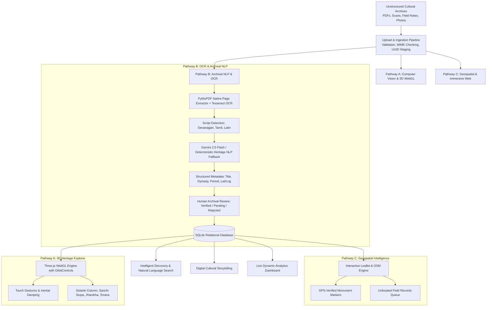

# HeritageLens AI
### From Historical Archives to Interactive Heritage Maps

**Hackathon Problem Statement:** HC26-CULT01 – Digital Revitalisation of Unstructured Cultural & Architectural Heritage Archives  
**Event:** Blithchron '27, IIT Gandhinagar  
**MVP Version:** 1.1.0 (Audited, Optimized & Production Deployed)  
**Live Public Deployment:** [https://elephant-lakes-pledge-metadata.trycloudflare.com](https://elephant-lakes-pledge-metadata.trycloudflare.com)  
**GitHub Repository:** [https://github.com/SurajPal589/heritage-website](https://github.com/SurajPal589/heritage-website)  

---

## 🏛️ Executive Summary

Currently, cultural documentation collected by students, researchers, explorers, and archaeologists is scattered across disconnected PDF reports, historical photographs, handwritten documents, regional language manuscripts, travel journals, and unindexed cloud folders.

**HeritageLens AI** solves this problem by providing a functional, production-ready, end-to-end platform that:
1. Ingests unstructured cultural records (PDFs, JPG, PNG).
2. Performs page-by-page text extraction with **PyMuPDF** (`pymupdf`) and optical character recognition with **Tesseract OCR** for scanned pages and images.
3. Automatically synthesizes structured heritage metadata using **Gemini 2.5 Flash** with an authoritative, deterministic rule-based fallback.
4. Enforces a human verification loop where records are reviewed and classified as **Verified**, **Pending**, or **Rejected**.
5. Indexes verified heritage locations on an interactive **Leaflet & OpenStreetMap** geospatial interface.
6. Provides an interactive **3D WebGL Explorer** powered by Three.js with full mobile touch gestures (1-finger orbit, 2-finger pinch zoom, 2-finger pan) and desktop controls.
7. Computes live, real-time repository statistics directly from the relational database without hardcoded metrics.

---

## 🌟 Architecture & Innovation Pathways



---

## 🚀 Live Endpoints & System URLs

| Service / Interface | URL | Description |
| :--- | :--- | :--- |
| **Live Web Application** | `https://elephant-lakes-pledge-metadata.trycloudflare.com` | Accessible on Android phones & Laptops |
| **Local Frontend** | `http://localhost:5173` | React 19 + TypeScript + Vite |
| **Local Backend API** | `http://localhost:8000` | FastAPI Server |
| **Swagger API Documentation** | `http://localhost:8000/docs` | Interactive OpenAPI Specification |
| **ReDoc Documentation** | `http://localhost:8000/redoc` | Alternative API Documentation |
| **GitHub Repository** | `https://github.com/SurajPal589/heritage-website` | Complete source code |

---

## 📡 Complete List of Real Backend API Endpoints

### 1. Platform Health & Diagnostics
- `GET /api/health` — Returns system health status, service title (`HeritageLens AI`), version, and Gemini AI status.

### 2. Digital Archives Management
- `GET /api/archives/` — Returns paginated archives with filtering by `category`, `state`, `language`, `period`, `verification_status` (`verified`, `pending`, `rejected`), and sorting (`date_desc`, `date_asc`, `title`).
- `GET /api/archives/{id}` — Returns complete metadata, attached files, extracted text, and relations for a single record.
- `PUT /api/archives/{id}` — Updates editable fields and tags of an archival record.
- `DELETE /api/archives/{id}` — Permanently deletes an archive and cascades relations.

### 3. Upload & Ingestion
- `POST /api/upload/` — Validates and stages uploaded files (PDF, JPG, JPEG, PNG, WEBP, max 50MB) and returns a unique `job_uuid`.

### 4. OCR & AI Processing Pipeline
- `POST /api/processing/run/{job_uuid}` — Executes PyMuPDF page-by-page text extraction, Tesseract OCR for scanned pages/images, and AI/deterministic metadata generation.
- `GET /api/processing/{job_uuid}` — Retrieves the live status and extracted metadata for an active job.
- `POST /api/processing/commit` — Human verification endpoint that commits reviewed metadata into the database with explicit status (`verified`, `pending`, or `rejected`).

### 5. Natural Language Heritage Search
- `GET /api/search/?q={query}` — Multi-field search querying title, description, extracted text, keywords, and geographic location with relevance scoring.

### 6. Geospatial Coordinates & Mapping
- `GET /api/locations/` — Returns verified GPS markers mapped across India alongside the unlocated archives queue.

### 7. Cultural Narratives & Stories
- `GET /api/stories/` — Returns curated cultural stories.
- `GET /api/stories/{slug}` — Returns full interactive story with timeline events.

### 8. Dynamic Analytics
- `GET /api/analytics/` — Computes live platform metrics directly from the database:
  - `total_archives`
  - `total_uploaded_documents`
  - `total_verified_records`
  - `total_pending_records`
  - `total_rejected_records`
  - `total_heritage_locations`
  - Category, language, and geographic distributions.

---

## 🛠️ Technical Approach

1. **PDF Text Extraction with PyMuPDF (`pymupdf`):**
   - Extracts text page-by-page preserving page numbers.
   - Detects scanned documents or pages with little/no text (`< 30` characters).
   - Renders low-text pages to 150 DPI pixmaps and selectively applies Tesseract OCR, avoiding expensive or redundant OCR on clean text PDFs.

2. **AI & Deterministic Rule-Based Metadata Extraction:**
   - Extracts structured schema: `heritage_name`, `heritage_category`, `location`, `state`, `country`, `historical_period`, `description`, `keywords`, `source_document`, `source_page`, `latitude`, `longitude`, `verification_status: "pending"`.
   - Uses Gemini 2.5 Flash when an API key is configured.
   - Features a deterministic heritage knowledge base as a transparent fallback.
   - **Zero Geographical Hallucination:** Coordinates are strictly verified against an authenticated monument registry; unconfirmed locations are flagged as `null` and held in the unlocated queue.

3. **Human-in-the-Loop Verification:**
   - AI outputs are never automatically assumed to be verified facts.
   - Archivists review suggestions, refine historical periods, edit categories, and choose between **Approve & Mark Verified**, **Save as Pending**, or **Reject Suggestion**.

4. **3D WebGL Heritage Explorer:**
   - Built on Three.js with official `OrbitControls`.
   - Supports 1-finger orbit, 2-finger pinch zoom, and 2-finger pan for mobile touchscreens (Android & iOS) and mouse controls for desktop.
   - Employs `ResizeObserver` to eliminate zero-dimension camera projection bugs.
   - Features architectural models: Solanki Stepwell Column, Sanchi Great Stupa, Jharokha Balcony, and Torana Gateway.

---

## ⚖️ Known Limitations

1. **OCR on Damaged Manuscripts:** Heavily degraded or water-damaged manuscripts with faint ink may produce low OCR confidence and require manual transcription.
2. **Third-Party AI Quota:** If Gemini API rate limits are exceeded, the system automatically falls back to the deterministic NLP engine.
3. **Georeferencing Uncertainty:** Monuments mentioned without specific village or district names cannot be pinned on the map and remain in the unlocated records section.

---

## 💻 Local Setup & Development Instructions

### Prerequisites
- Python 3.11+
- Node.js 18+
- Git

### 1. Backend Setup
```bash
# Clone the repository
git clone https://github.com/SurajPal589/heritage-website.git
cd heritage-website/backend

# Create and activate virtual environment
python -m venv venv
# On Windows:
.\venv\Scripts\activate
# On Linux/macOS:
source venv/bin/activate

# Install dependencies
pip install -r requirements.txt

# Run automated tests
pytest

# Launch FastAPI server
python -m uvicorn app.main:app --reload --port 8000
```

### 2. Frontend Setup
```bash
# In a separate terminal, navigate to frontend directory
cd frontend

# Install Node dependencies
npm install

# Build for production
npm run build

# Start Vite dev server
npm run dev
```

---

## 🧪 Automated Testing

HeritageLens AI includes comprehensive automated tests covering API endpoints, upload lifecycle, OCR fallback, natural language search, database persistence, and verification status filtering:

```bash
cd backend
pytest
```

**Results:**
- `test_api.py::test_health_check` ✅ PASSED
- `test_api.py::test_list_archives` ✅ PASSED
- `test_api.py::test_archive_detail` ✅ PASSED
- `test_api.py::test_natural_language_search` ✅ PASSED
- `test_api.py::test_locations_endpoint` ✅ PASSED
- `test_api.py::test_stories_endpoint` ✅ PASSED
- `test_api.py::test_analytics_endpoint` ✅ PASSED
- `test_api.py::test_upload_and_ocr_flow` ✅ PASSED
- `test_api.py::test_verification_and_analytics_breakdown` ✅ PASSED
- `test_e2e_workflow.py::test_full_heritage_revitalisation_e2e_lifecycle` ✅ PASSED
**10 passed in 2.66s**
