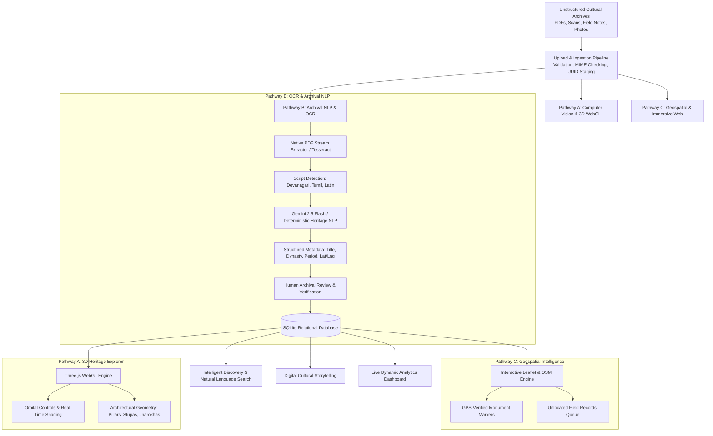
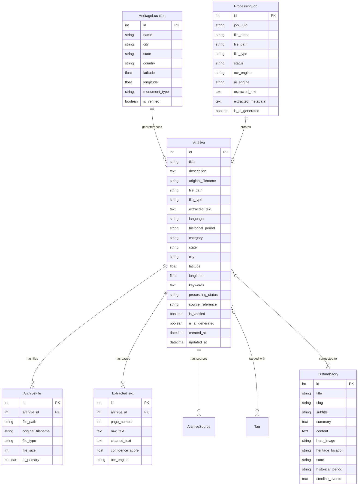

# HeritageVerse AI
### Discover. Preserve. Experience. India's Living Heritage.

**Hackathon Problem Statement:** HC26-CULT01 – Digital Revitalisation of Unstructured Cultural & Architectural Heritage Archives  
**Organization:** Blithchron '27, IIT Gandhinagar  
**MVP Version:** 1.0.0 (Production Hackathon Delivery)  

---

## 🏛️ Executive Summary

Currently, cultural documentation collected by students, researchers, explorers, and archaeologists is scattered across disconnected PDF reports, historical photographs, handwritten documents, regional language manuscripts, travel journals, and unindexed cloud folders.

**HeritageVerse AI** solves this problem by providing a functional, production-ready, end-to-end platform that ingests unstructured cultural records, runs bilingual Optical Character Recognition (OCR) and multimodal vision extraction, dynamically synthesizes structured epigraphic metadata via Gemini AI / deterministic NLP, georeferences historical monuments on an interactive Leaflet map, and provides an interactive 3D WebGL architectural explorer.

---

## 🌟 The Three Innovation Pathways



---

## 🗄️ Database Architecture

HeritageVerse AI employs a 10-entity relational database schema in SQLite with full foreign key constraints, cascading deletions, and indexed queries.



---

## 🚀 Application Routes & Features

| Route | Name | Key Functionality |
| :--- | :--- | :--- |
| `/` | **Landing Page** | Editorial museum design, live database metrics, problem statement, featured monuments, and 4-step workflow. |
| `/dashboard` | **Main Dashboard** | Dynamic analytics, categories distribution, language/script breakdown, geographic distribution, recent archives, live processing activity. |
| `/archives` | **Digital Archives** | Catalog of historical records, grid/list view toggle, multi-facet filtering (Category, State, Language, Period), sorting. |
| `/archives/:id` | **Archive Detail** | High-res document viewer, full OCR text copyable, mini Leaflet map, provenance citation, edit & delete modals. |
| `/upload` | **Upload Centre** | Drag-and-drop dropzone, MIME validation, 50MB limit, file preview, instant transition to AI extraction. |
| `/processing` | **AI Processing Centre** | Step progress tracker, raw OCR preview, bilingual Devanagari detection, editable metadata form, save to DB. |
| `/explore` | **Intelligent Search** | Natural language query understanding, query tokenization, relevance scoring, matched field highlights, snippets. |
| `/map` | **Geospatial Map** | Interactive Leaflet map, custom terracotta pins, monument inspector popup, unlocated records queue. |
| `/3d-explorer` | **3D Heritage Explorer** | Three.js WebGL canvas, 4 architectural models, rotate/zoom/pan/reset, wireframe toggle, fullscreen, architectural highlights. |
| `/stories` | **Cultural Stories** | Curated narratives (Rani ki Vav, Adalaj, Modhera, Hampi) with timeline milestones and connected archival records. |
| `/stories/:slug` | **Story Detail** | Editorial narrative essay, historical timeline, architectural features breakdown, connected archives. |
| `/about` | **About & Methodology** | Problem Statement HC26-CULT01, IIT Gandhinagar Blithchron '27, architecture diagram, ethical principles. |

---

## 💻 Tech Stack

- **Backend:** FastAPI, Python 3.14, SQLAlchemy, Pydantic v2, PyPDF, Tesseract OCR, PIL, Google GenAI SDK.
- **Frontend:** React 19, TypeScript, Vite, Tailwind CSS, Leaflet, Three.js, Lucide Icons, React Router v7.
- **Database:** SQLite (persisted relational schema with foreign keys and cascade rules).
- **Design Palette:** Museum editorial theme (Warm Ivory `#faf7f2`, Sandstone `#d8c4a0`, Deep Navy `#0c1524`, Terracotta `#bf533b`, Gold `#cba135`).

---

## ⚡ Quickstart Instructions

### 1. Prerequisites
- Python 3.10+ (Tested on Python 3.14)
- Node.js v18+ (Tested on Node.js v24.20)
- npm or yarn

### 2. Backend Setup
```bash
# Navigate to backend directory
cd backend

# (Optional) Set up virtual environment
python -m venv venv
# On Windows: venv\Scripts\activate
# On Linux/macOS: source venv/bin/activate

# Install dependencies
pip install fastapi uvicorn sqlalchemy pydantic pillow pypdf pytesseract google-genai httpx pytest

# Start FastAPI server
uvicorn app.main:app --reload --port 8000
```
Backend API will be live at: `http://localhost:8000`  
Swagger Documentation: `http://localhost:8000/docs`  
Database `heritageverse.db` will automatically initialize and seed 14 Indian heritage records!

### 3. Frontend Setup
```bash
# In a separate terminal, navigate to frontend directory
cd frontend

# Install dependencies (already completed)
npm install

# Start Vite development server
npm run dev
```
Frontend will be live at: `http://localhost:5173`

---

## 🧪 Automated Test Suite

We maintain automated tests covering endpoints, upload lifecycle, OCR fallback, natural language search, and database persistence:

```bash
cd backend
python -m pytest
```

**Results:**
- `test_api.py::test_health_check` ✅ PASSED
- `test_api.py::test_list_archives` ✅ PASSED
- `test_api.py::test_archive_detail` ✅ PASSED
- `test_api.py::test_natural_language_search` ✅ PASSED
- `test_api.py::test_locations_endpoint` ✅ PASSED
- `test_api.py::test_stories_endpoint` ✅ PASSED
- `test_api.py::test_analytics_endpoint` ✅ PASSED
- `test_api.py::test_upload_and_ocr_flow` ✅ PASSED
- `test_e2e_workflow.py::test_full_heritage_revitalisation_e2e_lifecycle` ✅ PASSED

---

## 🎬 2–3 Minute Judge-Facing Demo Script

1. **Introduction (0:00 - 0:30):**
   - Open `http://localhost:5173`.
   - Point to the hero headline: *"Preserving Yesterday. Discovering Tomorrow."*
   - Highlight the live dynamic counters (14+ archives, 12 verified coordinates) computed directly from the relational database.
   - Explain the hackathon problem statement HC26-CULT01 for Blithchron '27, IIT Gandhinagar: unstructured cultural data trapped in disparate PDFs, photos, and manuscripts.

2. **AI Archival Digitisation & OCR (0:30 - 1:15):**
   - Click **"Digitise an Archive"** (`/upload`).
   - Drag & drop a historical PDF or survey photo.
   - Watch the pipeline transition automatically into the **AI Processing Centre** (`/processing`).
   - Show the real OCR extraction: bilingual Devanagari script detection, raw extracted text, and AI/deterministic metadata inference.
   - Edit the title or tags live, click **"Save to Digital Archive"**, and show the created permanent record in `/archives/:id`.

3. **Intelligent Natural Language Search (1:15 - 1:45):**
   - Navigate to **"Intelligent Search"** (`/explore`).
   - Click the prompt *"Find ancient stepwells in Gujarat"*.
   - Show how the search parser identifies the category `Stepwells & Water Architecture`, filters by `Gujarat`, and calculates relevance scores with matched field indicators.

4. **Geospatial & 3D WebGL Explorer (1:45 - 2:30):**
   - Navigate to **"Geospatial Map"** (`/map`). Show verified markers across India (Rani ki Vav, Adalaj, Modhera, Hampi, Konark, Mehrangarh). Click on Adalaj Stepwell to open its popup.
   - Click the **"Unlocated Field Records"** drawer to show how records without GPS coordinates are handled ethically without hallucinated map points.
   - Navigate to **"3D Heritage Explorer"** (`/3d-explorer`). Orbit, zoom, and pan around the Solanki stepwell pavilion column and the Sanchi Stupa. Toggle architectural wireframe mode.

---

## ⚖️ Archival Ethics & Limitations

- **No Hallucinated Geography:** If a field survey note does not contain verified GPS coordinates, it is never plotted at an arbitrary location; it is held in the unlocated queue.
- **Transparent AI Labelling:** Fallback extractions are never falsely labeled as AI-generated; the system explicitly reports whether Gemini or the deterministic NLP engine was used.
- **Future Roadmap:** Multi-view stereo photogrammetry (COLMAP) and 3D Gaussian Splatting for photorealistic reconstruction from sets of community-contributed photographs.

