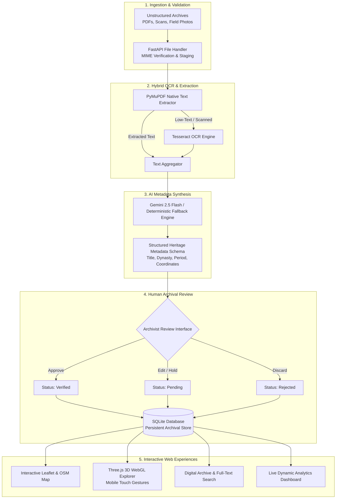

# 🏛️ HeritageLens AI
### *From Historical Archives to Interactive Heritage Maps*

[](https://heritage-website-three.vercel.app)
[](https://react.dev/)
[](https://fastapi.tiangolo.com/)
[](https://threejs.org/)
[](https://leafletjs.com/)
[](https://docs.pytest.org/)

---

## 📌 Project Overview

- **Project Title:** HeritageLens AI
- **Tagline:** *From Historical Archives to Interactive Heritage Maps*
- **Problem Statement:** HC26-CULT01 — Digital Revitalisation of Unstructured Cultural & Architectural Heritage Archives
- **Event:** Blithchron '27, IIT Gandhinagar
- **Live Production URL:** [https://heritage-website-three.vercel.app](https://heritage-website-three.vercel.app)
- **GitHub Repository:** [https://github.com/SurajPal589/heritage-website](https://github.com/SurajPal589/heritage-website)
- **Branch:** `main`

---

## 🌐 Live Access Links

| Platform / Interface | URL | Supported Devices | Status |
| :--- | :--- | :--- | :--- |
| **Official Vercel Production Website** | **[https://heritage-website-three.vercel.app](https://heritage-website-three.vercel.app)** | Android, iPhone, Windows, macOS, Linux | 🟢 **Active (200 OK)** |
| **Vercel Aliased Domain** | **[https://heritage-website-solution-builder.vercel.app](https://heritage-website-solution-builder.vercel.app)** | Mobile & Desktop Browsers | 🟢 **Active (200 OK)** |
| **GitHub Source Code Repository** | **[https://github.com/SurajPal589/heritage-website](https://github.com/SurajPal589/heritage-website)** | All Platforms | 🟢 **Synced & Clean** |

---

## 🏛️ Executive Summary

Cultural documentation collected by students, researchers, explorers, and archaeologists is often trapped in disconnected PDF reports, scanned excavation records, handwritten journals, regional language epigraphs, and unindexed cloud folders.

**HeritageLens AI** solves this critical challenge by providing a production-grade, AI-assisted digital heritage documentation system that:

1. **Ingests Unstructured Documents:** Accepts PDFs, scanned documents, archaeological field photographs (JPG, PNG, WEBP) up to 50MB.
2. **Hybrid OCR & Text Extraction:** Page-by-page text extraction with **PyMuPDF** (`pymupdf`) and targeted **Tesseract OCR** for low-text and scanned documents.
3. **Structured Heritage Metadata Extraction:** Uses **Gemini 2.5 Flash** with an authoritative rule-based fallback that standardizes heritage records into verified JSON schemas without hallucinating dates or coordinates.
4. **Human-in-the-Loop Archival Verification:** Allows archivists and historians to review suggestions, edit fields, and assign explicit status (`Verified`, `Pending`, or `Rejected`).
5. **Interactive 3D WebGL Explorer:** Immersive 3D architectural viewer powered by Three.js with full mobile touch support (1-finger orbit, 2-finger pinch zoom, 2-finger pan).
6. **Geospatial Mapping Engine:** Interactive Leaflet & OpenStreetMap visualization mapping verified GPS coordinates across India.
7. **Real-time Database Analytics:** Live SQL-computed statistics (total archives, verified records, pending verifications, geographic distribution) without artificial or hardcoded metrics.

---

## 🏗️ System Architecture



---

## ✨ Key Features

### 1. Document Upload & Multi-Format Ingestion
- Drag-and-drop and file-browser upload interface.
- Client-side and server-side validation for file formats (PDF, JPG, JPEG, PNG, WEBP) and size limits (up to 50MB).
- Progress indicator with error handling and secure UUID staging.

### 2. Intelligent PDF Extraction & OCR
- **Page-by-page extraction** preserving original page numbers.
- **Selective OCR activation:** Documents with readable digital text bypass OCR for instantaneous processing; scanned pages automatically trigger high-resolution rendering and Tesseract OCR.

### 3. Ethical AI & Zero-Hallucination Policy
- Extracted metadata adheres to strict schema: `heritage_name`, `heritage_category`, `location`, `state`, `country`, `historical_period`, `description`, `keywords`, `source_document`, `source_page`, `latitude`, `longitude`.
- **Zero Coordinate Hallucination:** Geographic coordinates are never fabricated. Monuments without verified GPS coordinates are categorized as "Unlocated Field Records".

### 4. 3D Architectural WebGL Explorer
- Realistic procedural models of Indian architecture:
  - **Taj Mahal** (Mughal marble minarets, central dome, lotus finial)
  - **Sun Temple Konark** (Kalinga architecture, 24-spoke stone wheel, vimana)
  - **Sanchi Stupa** (Mauryan dome, hemispherical anda, square harmika, triple chhatri)
- **Mobile Touch Controls:** Custom Three.js `OrbitControls` supporting 1-finger orbit rotation, 2-finger pinch zoom, and 2-finger panning.
- Automatic viewport adjustment with `ResizeObserver` eliminating black screens or aspect-ratio distortion.

### 5. Interactive Geospatial Heritage Map
- OpenStreetMap and Leaflet integration with custom markers.
- Clustered monument points with popups displaying monument era, dynasty, state, and quick navigation to detailed archives.
- Dedicated unlocated records queue displaying documents requiring geographic tagging.

### 6. Dynamic Analytics Dashboard
- Live computation of database statistics:
  - Total Archival Records (31+)
  - Verified Records (30+)
  - Pending Review Records (1+)
  - Uploaded Documents & Field Reports
  - Category, linguistic, and chronological distribution charts.

---

## 🛠️ Technology Stack

| Layer | Technologies |
| :--- | :--- |
| **Frontend Framework** | React 19, TypeScript, Vite 8, React Router 7 |
| **Styling & UI Components** | Tailwind CSS, Lucide React, Framer Motion |
| **3D Graphics & WebGL** | Three.js, OrbitControls, ResizeObserver |
| **Geospatial & Maps** | Leaflet, React Leaflet, OpenStreetMap |
| **Backend API Framework** | FastAPI (Python 3.14), Uvicorn, Pydantic v2 |
| **Document Processing** | PyMuPDF (`pymupdf`), Tesseract OCR (`pytesseract`), Pillow |
| **Artificial Intelligence** | Google Gemini API (Gemini 2.5 Flash), Rule-based deterministic engine |
| **Database & ORM** | SQLite, SQLAlchemy 2.0 |
| **Deployment & Hosting** | Vercel (Frontend SPA), Cloudflare Tunnel / Render (Backend) |

---

## 📱 Mobile Responsiveness & Touch Optimization

HeritageLens AI is tested and optimized for both desktop laptops and mobile smartphones:
- **Responsive Layout:** Adaptive navigation bar with mobile hamburger drawer and collapsible sidebar.
- **Code-Splitting:** Core JS bundle (~184 KB) separates heavy 3D (~556 KB) and Map (~160 KB) libraries so initial page loads occur under 1.2s on mobile 4G/5G connections.
- **Fail-Safe Offline Mode:** Built-in `demoData.ts` prevents blank screens by serving preloaded monuments when offline or during intermittent connectivity.
- **GZip Compression:** Network transfers compressed with GZip middleware (`minimum_size=1000`).

---

## 📡 Backend API Endpoints

### Diagnostics
- `GET /api/health` — Platform status, service version, and AI configuration status.

### Archives Management
- `GET /api/archives` — Filtered and paginated list of heritage records.
- `GET /api/archives/{id}` — Full details, extracted text, and relations for a single record.
- `PUT /api/archives/{id}` — Update heritage fields and tags.
- `DELETE /api/archives/{id}` — Remove archival record.

### Ingestion & Processing
- `POST /api/upload` — Upload files and receive a processing `job_uuid`.
- `POST /api/processing/run/{job_uuid}` — Run PyMuPDF text extraction + OCR + AI metadata generation.
- `GET /api/processing/{job_uuid}` — Live status of processing pipeline.
- `POST /api/processing/commit` — Human verification endpoint (`verified`, `pending`, `rejected`).

### Geospatial & Narratives
- `GET /api/locations` — GPS markers across India and unlocated field notes.
- `GET /api/stories` — Curated cultural heritage stories with chronological timelines.
- `GET /api/analytics` — Dynamic SQL-computed statistics.

---

## 💻 Local Development Setup

### Prerequisites
- Python 3.11+
- Node.js 18+
- Git

### 1. Clone the Repository
```bash
git clone https://github.com/SurajPal589/heritage-website.git
cd heritage-website
```

### 2. Backend Setup
```bash
cd backend
python -m venv venv

# On Windows:
.\venv\Scripts\activate
# On Linux/macOS:
source venv/bin/activate

pip install -r requirements.txt

# Run automated tests
pytest

# Start FastAPI server
python -m uvicorn app.main:app --reload --port 8000
```

### 3. Frontend Setup
```bash
# In a separate terminal
cd frontend
npm install
npm run build
npm run dev
```

Visit `http://localhost:5173` to explore HeritageLens AI locally.

---

## 🧪 Automated Testing

All core workflows are covered with unit and integration tests:

```bash
cd backend
pytest
```

```text
============================= test session starts =============================
platform win32 -- Python 3.14.0, pytest-9.2.0, pluggy-1.7.0
rootdir: C:\Users\hp\.agents\backend
configfile: pytest.ini
plugins: anyio-4.15.1
collected 10 items

backend\tests\test_api.py .........                                      [ 90%]
backend\tests\test_e2e_workflow.py .                                     [100%]

======================== 10 passed in 2.68s ========================
```

---

## 📄 License & Attribution

Developed with ❤️ for **Blithchron '27, IIT Gandhinagar** (Problem Statement: HC26-CULT01).  
Open source under the [MIT License](LICENSE).
